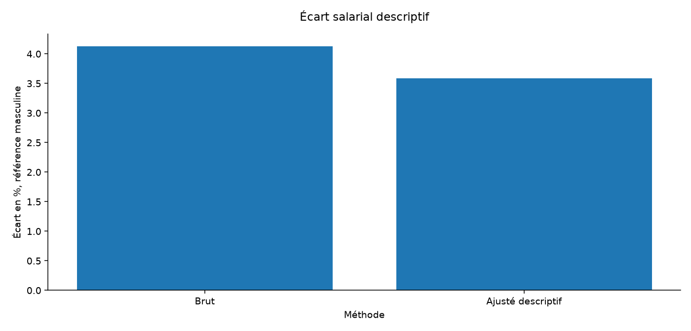

# EquiTech — diagnostic des rémunérations

Expliquer l’écart salarial observé, séparer composition des postes et association ajustée, puis construire une restitution agrégée maîtrisant les risques de diffusion.

## Mon approche

Je contrôle la qualité des données et les clés avant de calculer les indicateurs. Je compare les résultats, explicite les hypothèses et propose des actions à vérifier avec le métier. Ce projet utilise des données synthétiques et ne correspond à aucune mission réelle.

## Méthodes

- Normalisation ETP, contrôle des doublons/rejets et comparaison moyenne-médiane.
- Bootstrap de 500 réplications pour l’écart brut ; interprétation de l’intervalle.
- Régression log avec erreurs HC3, coefficient exponentié et analyse des catégories de référence.
- Agrégation par site/métier/niveau/sexe, suppression des petites cellules et discussion du secret secondaire.

## Livrables

- [Notebook Jupyter](notebooks/analyse.ipynb) : calculs exécutés, graphiques et analyse détaillée.
- [Rapport PowerPoint](presentation/soutenance.pptx) : présentation modifiable.
- [Rapport PDF](presentation/soutenance.pdf) : version de lecture.
- [Synthèse des résultats](analysis/SYNTHESE.md).
- `data/` et `analysis/` : sources, tables nettoyées et résultats au format CSV.

## Reproduire l’analyse

Installer Python 3.12 et les dépendances avec `python -m pip install -r requirements.txt`. Ouvrir le notebook dans Jupyter ou VS Code, choisir le noyau Python installé et exécuter toutes les cellules dans l’ordre. La graine de simulation est fixe. Les sources sont régénérées à l’exécution ; ne pas remplacer ces CSV par des données réelles sans adapter le chargement.

La dernière cellule recrée le PowerPoint. Pour actualiser le PDF après modification, ouvrir la présentation dans PowerPoint ou LibreOffice Impress puis l’exporter en PDF. Les graphiques sont des images et les textes restent modifiables.

Les données fictives, les méthodes et les limites sont détaillées dans le notebook. Les résultats ne constituent pas une performance démontrée en situation réelle.

## Aperçu

## Quelques repères

Ces valeurs décrivent le jeu synthétique utilisé dans ce projet.

| Indicateur | Valeur |
|---|---:|
| effectif | 11 970 |
| ecart brut | 0,0413 |
| ic95 brut bas | 0,0307 |
| ic95 brut haut | 0,0519 |
